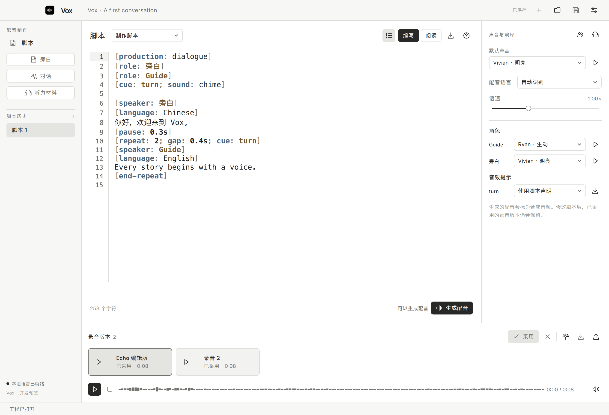
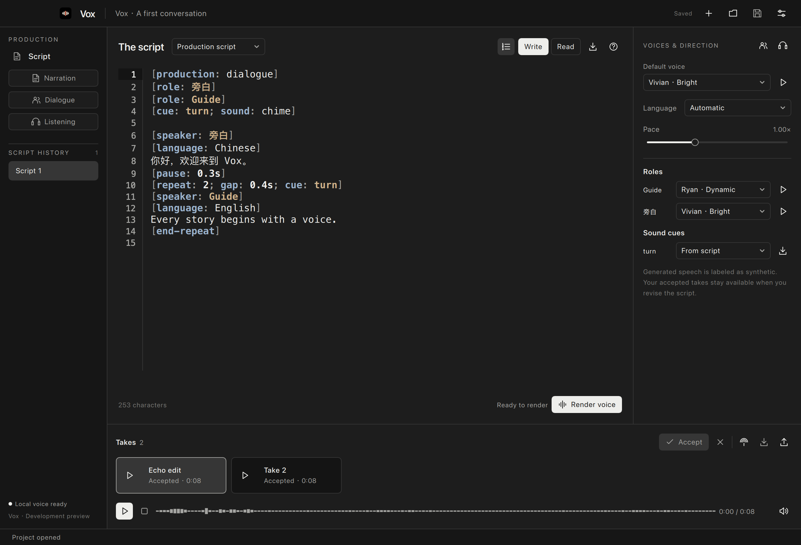

# Vox

[简体中文](#简体中文) · [English](#english)

## 简体中文

**脚本驱动的配音制作。**

Vox 是独立的 Qt 桌面应用，用于旁白、多角色对话、听力材料和声音素材制作。从脚本编写、音色选择、
本地合成到试听、采用与导出，保留每一版脚本和已采用的录音。当前为开发预览，尚未发布正式版本；
最初验证的平台为 macOS Apple Silicon。

### 界面预览



脚本编辑、角色配音和录音版本集中在一个工作区。截图来自 macOS 开发预览的独立演示项目。

### 制作流程

1. 新建 `.vox` 项目，编写或导入 UTF-8 文本，选择旁白、对话或听力模板。
2. 为默认旁白和各角色选择预设音色或参考音色，设置配音语言、语速与音效提示。
3. 生成候选录音，试听、比较后明确采用，再导出 WAV。修改脚本后，旧录音仍然保留。
4. 需要裁剪、淡入淡出或混音时，在 [Echo](https://github.com/glenzli/echo) 中编辑副本，
   将导出的 WAV 返回 Vox，作为新候选试听和采用。

### 功能

| 功能 | 当前支持 |
| --- | --- |
| 脚本编辑 | 语法高亮、逻辑行号、自动换行；阅读页按角色台词和重复段分组，可定位原文；脚本区字体和字号可独立设置、预览与重置 |
| 多角色配音 | 复用 Shape 的脚本语法，支持角色、演绎、场景、停顿、音效与重复；重复片段重放同一份 PCM，不重复调用模型 |
| 分段制作 | 单段生成与重生成、候选比较、逐段采用；复用文字与设置完全相同的段落，拼装成新的整段候选；按实际音频时长导出 SRT/VTT |
| 读音词典 | 项目内保存原词与读法，可限定语言或角色；只改变送入合成的文字，脚本原文保持不变 |
| 预设音色 | 九种预设音色，可自动识别或明确指定配音语言 |
| 音色模仿 | 现场录音或导入单声道/立体声 PCM16 WAV，填写逐字参考文本并确认使用权限；可分配给旁白或任意角色 |
| 音色设计 | 用文字描述声音，生成最多四份样音；试听后命名保存为合成参考音色，复用于默认旁白或角色 |
| 长内容制作 | 按章节导入和编写，复用音色与发音设置；批量生成、停止与续作，只重做变化的分段，逐章审阅和采用，再导出章节包 |
| 声音工作区 | 音效、环境声、短配乐三个入口；本地生成、批量候选、循环试听、原始 WAV 导出与 Echo 编辑 |
| 音效库 | 八种程序生成的内置音效、WAV 导入；采用后可绑定脚本音效提示 |
| 版本与素材 | 独立项目、自动保存的工作草稿、不可变素材、明确采用的脚本与录音版本 |
| Echo 联动 | 对录音、参考音色和音效建立独立编辑副本，保留原始素材，手动导入编辑后的 WAV |
| 界面 | 紧凑的图标工具栏，黑白灰主色，中英文界面，亮色、暗色和跟随系统主题 |

参考音色的原始音频、逐字文本和授权确认保存在当前项目中；只有点击录音才申请麦克风权限。
当前 Base 音色模仿使用 1× 语速和中性演绎。自动化检查使用合成参考和注入的音频样本，
真实麦克风采集仍需设备和首次系统授权。

音色设计保留描述、样本文本、原始音频和本地模型回执。保存音色后，后续配音通过参考音色合成保持声音身份，
不会每句重新设计。设计样音明确标记为合成声音，与录制或导入的真人参考分别记录。

长内容的每章保存在当前 `.vox` 工程内，可继续使用脚本编辑、角色配置、分段试听和 Echo 编辑。
Markdown 按一级标题分章；一级标题不足时使用二级标题，长段落和纯文本按大小继续拆分，并保留导入原文。
批量生成产出待审阅的录音，不自动采用；取消和失败保留已完成的分段，重试复用匹配的结果。
意外中断的任务需明确重试。章节包只导出当前已采用版本；附带 WAV、脚本与来源清单，
有准确分段时间时同时导出 SRT/VTT。Echo 编辑后的音频若没有新时间依据，不沿用编辑前字幕。

声音生成支持 1–30 秒、显式随机种子、最多四个变体和中英文描述。短配乐限定为器乐素材，完整歌曲不在 Vox 范围内。
环境声使用音效模型；循环试听用于检查首尾衔接，不保证模型输出无缝循环。中文描述经过本地提示词准备，
原文、实际提示词和 Runtime 回执一并保留。试听并采用后，Vox 准备用于脚本的音频副本，
同时保留原始 WAV 供导出或 Echo 编辑。

Echo 返回的音频先进入候选列表；24 位到 16 位 PCM 的转换需要明确选择。
两款应用通过文件交接，各自管理项目和数据库。

### 本地运行

需要 Rust 1.96+、CMake 3.28+、Ninja，以及包含 Quick、Quick Controls、Multimedia、SVG 和
Linguist Tools 的 Qt 6.9+。首次构建先联网下载锁定的依赖（包括固定版本的 Infer Runtime SDK），
之后构建脚本使用离线 Cargo 缓存。无需本机 Infer Runtime 源码检出或预置 SDK 缓存。

```sh
cargo fetch --locked
./scripts/build_and_promote_debug.sh
./scripts/run_debug.sh
./scripts/run_debug.sh /absolute/path/MyProject.vox
```

构建产物和当前 Debug 应用默认放在仓库旁的 `.vox-local-build`。可使用 `VOX_LOCAL_BUILD_ROOT`、
`VOX_BUILD_DIR` 和 `VOX_CARGO_TARGET_DIR` 指定其他仓库外路径。应用包包含 `vox-cli`；
开发机器仍需安装 Qt。可分发打包、签名公证与正式发布另行进行。

#### 连接 Infer Runtime

Vox 使用自己的 `vox` 应用授权，合成限定为本地、零费用且不回退的执行路径。
在 Infer Console 签发独立凭据后，可从 Vox 设置导入。操作辅助脚本见：

```sh
python3 scripts/provision_infer.py --help
```

默认凭据位置为 `~/.config/vox/infer-credential`；`--studio` 额外申请 Vox 的本地参考音色、
音效生成和中文提示词准备权限；`--voice-design` 增加本地音色设计与参考音色复用权限。
授权变更需在 Console 队列空闲时进行并重启生效。Vox 不使用 Shape 凭据；
Runtime 离线时，脚本编辑和已保存音频仍可使用。

### 开发与文档

| 目录 | 职责 |
| --- | --- |
| `crates/vox-core/src/domain` | 音频约定与兼容 Shape 的脚本语法 |
| `crates/vox-core/src/assembly.rs` | 有界的脚本编译、PCM 组装与校验 |
| `crates/vox-core/src/infer_runtime` | 官方 SDK、Vox 身份、本地合成与进度 |
| `crates/vox-core/src/project` | 独立项目、草稿、不可变素材与采用流程 |
| `crates/vox-core/src/handoff.rs` | Echo 编辑副本、显式返回与 PCM24 转换 |
| `apps/vox-cli` | 桌面应用、用户与自动化共用的 JSON 操作 |
| `apps/desktop` | Qt/QML 编辑、演绎配置、试听与审阅界面 |

参见[架构](docs/ARCHITECTURE.md)、[自动化接口](docs/AUTOMATION.md)、
[脚本语法](docs/SPEECH_SCRIPT.md)、[验证记录](docs/VALIDATION.md)、[路线图](ROADMAP.md)
和[图标来源](assets/branding/README.md)。

Vox 复用了 Shape 的语音制作代码，保留其来源和许可。Shape 的配音制作工作台收敛到 Vox，
旧工程保留读取与精确交接：选中文稿、写作与配音草稿、角色选声、音效和可选已采用音频，
导入独立 `.vox` 工程。已采用历史与未完成工作稿分别保留，可在侧栏恢复迁移的写作或配音草稿。
原 `.shape` 工程不改动，也不自动转换其中其他作品。迁移合同见 [Shape 交接](docs/SHAPE_TRANSFER.md)。
表演驱动的换声和带时码的视频配音列入后续规划。当前字幕导出使用已组装音频的实际段落时长；
它不执行词级强制对齐，也不承诺生成音频恰好匹配外部视频时长。

### 许可证

Vox 采用 [MIT License](LICENSE)。迁移代码和依赖的来源及许可见
[第三方声明](THIRD_PARTY_NOTICES.md)与 [Shape 来源清单](docs/SHAPE_PROVENANCE.json)。
模型权重不随项目分发，其许可由相应提供方规定。

---

## English

**Script-led voice production.**

Vox is an independent Qt desktop application for narration, multi-speaker dialogue, listening
materials and sound assets. Write scripts, direct voices, synthesize locally, then audition, accept and export takes
while keeping exact script versions and accepted audio. This is a development preview, not a published
release. macOS Apple Silicon is the initial verified platform.

### Interface preview



Script editing, voice direction and takes share one workspace. These screenshots show the macOS development preview with an isolated demo project.

### Workflow

1. Create a `.vox` project, write or import UTF-8 text, and choose a narration, dialogue or listening template.
2. Choose presets or reference voices for narration and individual roles; set language, pace and sound cues.
3. Render a candidate, listen and compare, explicitly accept your preferred take, then export WAV.
   Earlier accepted takes remain available after script revisions.
4. For trimming, fades or mixing, edit a copy in [Echo](https://github.com/glenzli/echo), then return its
   exported WAV to Vox for review and acceptance as a new candidate.

### Features

| Feature | Available now |
| --- | --- |
| Script editor | Syntax highlighting, logical line numbers, wrapping, grouped speech/repeat reading with source navigation, and independent script font/size settings with preview and reset |
| Multi-speaker production | Shape-compatible roles, delivery, scenes, pauses, cues and repeats; repeats replay identical PCM without another model call |
| Segment production | Generate or regenerate one segment, compare and explicitly select candidates, reuse exact matching text/settings, assemble a new whole-take candidate, and export measured SRT/VTT captions |
| Pronunciation dictionary | Project-owned text-to-reading rules, optionally scoped by language or role; synthesis input changes while authored source remains intact |
| Voice presets | Nine presets, with automatic or explicit speech language |
| Reference voices | Record a microphone sample or import mono/stereo PCM16 WAV, enter its exact transcript and confirm permitted use; assign to narration or any role |
| Voice design | Describe a voice, generate up to four samples, then audition and explicitly save a named synthetic reference for narration or roles |
| Long-form production | Import and edit chapters, share voices and pronunciation, generate in batches, stop and resume, regenerate changed segments, review and accept chapters, then export a chapter package |
| Sound workspaces | Separate effects, ambience and short instrumental music entries; local generation, batch candidates, loop audition, original WAV export and Echo editing |
| Sound library | Eight procedural effects and WAV import; accepted materials can be bound to script cues |
| Versions and materials | Independent projects, autosaved drafts, immutable materials, and explicit script/audio acceptance |
| Echo handoff | Independent editing copies for takes, voice references and sounds, preserving originals with manual WAV return |
| Interface | Compact icon-led tools, a neutral black/white/gray palette, English/Chinese, and light/dark/system themes |

Original reference audio, exact transcripts and permitted-use confirmations stay in the project.
Microphone access is requested only when Record is pressed. The current Base clone route supports
1× pace and neutral delivery. Automated checks use synthetic references and injected audio samples;
real microphone capture requires a suitable device and first-use system permission.

Voice design retains the description, exact sample text, original audio and local model receipt.
Saved designs use the reference-voice synthesis route for subsequent speech, preserving the voice
instead of redesigning it for each line. Designed samples are labelled synthetic and retain a distinct
origin from recorded or imported human references.

Each chapter lives inside the current `.vox` project and reuses script editing, cast settings,
segment audition and Echo handoff. Markdown splits at repeated level-one headings, or repeated
level-two headings when needed; oversized sections and plain text split further by size, retaining
the original imported source. Batch output remains a candidate until reviewed and accepted.
Cancellation and failure retain completed segments; a later batch reuses matching results.
Unexpected interruption requires an explicit retry. Chapter packages contain only current accepted
versions, with WAV, authored scripts and provenance metadata. Measured SRT/VTT is included when
timing evidence exists; edited Echo audio never inherits captions whose timing is no longer verified.

Sound generation supports 1–30 seconds, an explicit seed, up to four variations, and English or Chinese descriptions.
Short music is instrumental; complete songs are outside Vox’s scope. Ambience uses the sound-effects model.
Loop audition helps inspect the join; it does not guarantee seamless model output.
Chinese descriptions use local prompt preparation; original and effective prompts and Runtime receipts
are retained. After audition and explicit acceptance, Vox prepares a script-compatible audio copy while
keeping the original WAV for export or Echo editing.

Echo returns enter the candidate list first. PCM24-to-PCM16 conversion requires an explicit choice.
The applications exchange files and retain independent project stores and databases.

### Run locally

Requires Rust 1.96+, CMake 3.28+, Ninja and Qt 6.9+ with Quick, Quick Controls, Multimedia, SVG and
Linguist Tools. Fetch the locked dependencies online for the first build, including the pinned Infer
Runtime SDK; the build script then uses Cargo's offline cache. No local Infer Runtime checkout or
pre-populated SDK cache is required.

```sh
cargo fetch --locked
./scripts/build_and_promote_debug.sh
./scripts/run_debug.sh
./scripts/run_debug.sh /absolute/path/MyProject.vox
```

Build products and the current Debug app live in the sibling `.vox-local-build`, outside the checkout.
`VOX_LOCAL_BUILD_ROOT`, `VOX_BUILD_DIR` and `VOX_CARGO_TARGET_DIR` select other external paths.
The app contains `vox-cli`; Qt must still be installed on the development host. Redistributable
packaging, notarization and public release are separate work.

#### Connect Infer Runtime

Vox uses its own `vox` App authorization for local-only, zero-cost, no-fallback synthesis.
Issue a separate credential in Infer Console and import it in Vox settings. The operator helper is
documented through:

```sh
python3 scripts/provision_infer.py --help
```

The default credential path is `~/.config/vox/infer-credential`. `--studio` additionally requests
Vox-only local reference voices, sound generation and Chinese prompt preparation. Apply grants while
Console queues are idle; `--voice-design` adds local voice design and reference reuse. Restart through
Console to activate changes. Vox does not use Shape's credential. Offline editing and saved audio remain usable.

### Development and documentation

| Owner | Responsibility |
| --- | --- |
| `crates/vox-core/src/domain` | Portable audio contracts and Shape-compatible script grammar |
| `crates/vox-core/src/assembly.rs` | Bounded script compilation, PCM assembly and validation |
| `crates/vox-core/src/infer_runtime` | Official SDK, Vox identity, local synthesis and progress |
| `crates/vox-core/src/project` | Independent bundles, drafts, immutable materials and acceptance |
| `crates/vox-core/src/handoff.rs` | Echo working copies, explicit return and PCM24 conversion |
| `apps/vox-cli` | Shared JSON operations for the desktop, users and automation |
| `apps/desktop` | Qt/QML authoring, voice direction, audition and review |

See [architecture](docs/ARCHITECTURE.md), [automation](docs/AUTOMATION.md),
[script rules](docs/SPEECH_SCRIPT.md), [validation](docs/VALIDATION.md), [roadmap](ROADMAP.md),
and [icon provenance](assets/branding/README.md).

Vox reuses Shape's speech production code with its provenance and license retained. Shape's voice
production workspace moves to Vox; existing projects retain a read/export path. Import a selected
script, writing and speech drafts, role choices, cues and optional accepted audio into an independent
`.vox` project. Accepted history and unfinished work remain distinct, with sidebar actions to restore
the preserved writing or speech draft. The original `.shape` project stays intact; other works in that
project are not automatically converted. See the [Shape transfer contract](docs/SHAPE_TRANSFER.md).
Performance-driven voice conversion and timecoded video dubbing remain future work.
Caption export uses measured durations of assembled segments; it does not perform word-level forced alignment
or guarantee a fit to external video timings.

### License

Vox is available under the [MIT License](LICENSE). Migrated code and dependency attribution are
recorded in [third-party notices](THIRD_PARTY_NOTICES.md) and the [Shape source manifest](docs/SHAPE_PROVENANCE.json).
Model weights are not distributed with the project; their providers determine their licenses.
